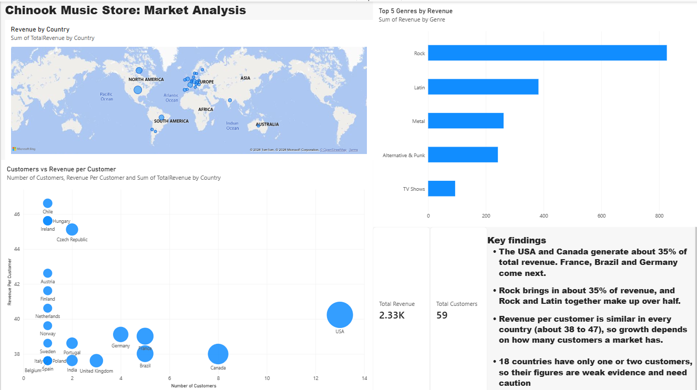

# Chinook Music Store: Market Analysis

**Business question:** Which countries and genres should the store prioritise for its next marketing budget, and why?

**Tools used:** SQL Server (SSMS), Excel, Power BI Desktop



## Dataset

[Chinook](https://github.com/lerocha/chinook-database) is a sample database for a digital music store. It holds customers, invoices, invoice lines, tracks and genres.

| Measure | Value |
|---|---|
| Countries | 24 |
| Customers | 59 |
| Invoices | 412 |
| Total revenue | 2,328.60 (currency units as recorded in the dataset) |

## Approach

### 1. SQL: extract the data
I loaded the SQL Server version of Chinook into SSMS and wrote four queries. Each query joins the tables it needs, and each result was exported as a CSV.

| Query | Purpose | Tables joined |
|---|---|---|
| `01_revenue_by_country.sql` | Revenue, orders and customers per country | Invoice, Customer |
| `02_top_genres.sql` | Top 5 genres by revenue | InvoiceLine, Track, Genre |
| `03_avg_order_value.sql` | Average order value per country | Invoice, Customer |
| `04_customer_revenue.sql` | Customers vs revenue per customer | Invoice, Customer |

### 2. Excel: clean, calculate, flag
- Imported each CSV into its own sheet and added header rows
- Built a PivotTable to cross-check the SQL totals against the source figures
- Calculated the mean, median and standard deviation of revenue across countries, and each country's share of total revenue
- Flagged countries with high revenue per customer but fewer than 3 customers, since those figures rest on very little evidence

| Statistic (revenue per country) | Value |
|---|---|
| Mean | 97.03 |
| Median | 44.12 |
| Standard deviation | 113.40 |

The mean is more than double the median and the standard deviation is larger than the mean, so revenue is concentrated in a few countries.

### 3. Power BI: visualise
The dashboard has a revenue map, a top-genres bar chart, a scatter plot of customers against revenue per customer, and summary cards for total revenue and total customers.

## Key findings

1. **Revenue is concentrated.** The USA (22.5%) and Canada (13.1%) together generate 35.5% of revenue. Adding France, Brazil, Germany and the UK brings the top six countries to 63.6%.
2. **Rock leads by a wide margin.** Rock brings in 35.5% of revenue and Latin 16.4%, so the two together make up 51.9%. Metal (11.2%) and Alternative & Punk (10.4%) follow. TV Shows is last of the top five at 4.0%.
3. **Spend per customer is almost the same everywhere.** Revenue per customer only ranges from about 37.6 to 46.6, so a market's revenue is driven by how many customers it has, not by how much each one spends.
4. **Most markets are thin.** 18 of the 24 countries have only one or two customers, and 15 of them have exactly one. Their figures are weak evidence.

## Recommendation

1. **Protect North America first.** The USA and Canada hold 35.5% of revenue and 21 of the 59 customers. Retention spend there defends the largest share of the business.
2. **Grow where there is already traction.** France, Brazil, Germany and the UK each have 3 to 5 customers and between 4.8% and 8.4% of revenue. Because each new customer is worth roughly the same everywhere, choose among these markets by the cost of acquiring a customer, which this dataset does not contain.
3. **Do not commit budget to single-customer markets on this data alone.** Chile and Hungary look strong on revenue per customer, but each figure comes from one customer.
4. **Lead campaigns with Rock and Latin.** Together they bring in just over half of revenue. Metal and Alternative & Punk are the next priority, and TV Shows is the lowest.

## Limitations

- The data has **no dates**, so I could not look at trends or seasonality.
- It has **no marketing cost data**, so I could not compare the return on spend between markets.
- Genre was **not broken down by country**, so the genre and country recommendations are separate. A genre-by-country analysis is the natural next step.
- In this sample every customer placed about 7 orders, so revenue per customer barely varies. That pattern comes from the sample dataset and may not hold for real customers.

## Repository structure

```
/SQL          the four SQL queries
/Data         CSV exports of each query result
/Excel        Excel workbook with the statistics and flags
/Dashboard    dashboard screenshots (and the .pbix file)
README.md
```
